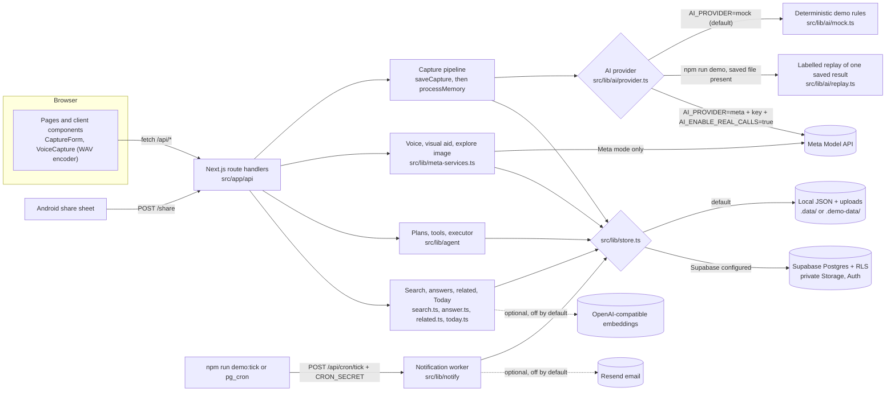

# Acorn

Acorn is a multimodal personal memory and follow-through agent. It helps people capture information from different sources, understand it, connect related memories, and turn saved information into actions.

> **Judges: the short version.** `npm ci` then `npm run demo` starts the whole app on <http://localhost:3200> with no account, no API key and no network calls. Everything that is not a real model result is labelled on screen. Full steps: [Local setup](#local-setup--judge-instructions).

## Contents

1. [Acorn](#what-acorn-is)
2. [Features built during the hackathon](#features-built-during-the-hackathon)
3. [Architecture](#architecture)
4. [Meta AI models and where they are used](#meta-ai-models-and-where-they-are-used)
5. [TTS and voice architecture](#tts-and-voice-architecture)
6. [Third-party services and dependencies](#third-party-services-and-dependencies)
7. [Third-party assets and attribution](#third-party-assets-and-attribution)
8. [Prerequisites](#prerequisites)
9. [Local setup — judge instructions](#local-setup--judge-instructions)
10. [Live Meta API setup](#live-meta-api-setup)

## What Acorn is

**The problem.** People save things all day: a screenshot of a job post, a recipe reel, a conference PDF, a link a friend sent, a thought said out loud. Almost none of it gets acted on. It sits in a camera roll or a bookmarks folder with no date, no context and no next step, and is forgotten by the time it matters.

**What Acorn does.** You save an item as it is. Acorn keeps the original, reads it into a structured memory (what it is, the facts it states with the words they rest on, dates and deadlines, people and things, a *guess* at why you saved it), connects it to what you saved before, and helps you follow through: a plan you approve, drafts you review, reminders that fire, and a Today list where every line says why it is there.

**How it differs from…**

| | What it does | What Acorn adds |
|---|---|---|
| A generic AI chatbot | Answers in a conversation, then forgets; you bring the context each time | A persistent memory of what *you* saved. Extracted facts carry a quote from the original, guesses are labelled as guesses, and nothing is decided for you |
| A bookmark manager | Stores the link | Reads what the item says (the deadline, the requirements, the ingredients) and what you might want to do with it, and keeps track of whether you did |
| A note-taking app | You organise by hand | Structure is extracted for you, related memories are linked with a stated reason, and follow-through (plans, reminders, evidence) is tracked |
| A basic RAG app | Retrieves text chunks to answer questions | Answers cite saved memories and drop citations that can't be found in them; beyond answering, Acorn holds intent, approval-gated plans, reminders and action states |

**The product loop.**

**CAPTURE → UNDERSTAND → REMEMBER → RETRIEVE → CONNECT → ACT → FOLLOW THROUGH**

| Step | What happens | Main code |
|---|---|---|
| Capture | A note, link, screenshot/photo, PDF or voice note is saved. The original is stored first, before anything reads it | `src/app/api/memories/route.ts`, `saveCapture` in `src/lib/process.ts`, `src/components/CaptureForm.tsx`, `src/components/VoiceCapture.tsx` |
| Understand | The AI provider extracts a structured reading; it is validated with Zod and quotes are checked against the saved text | `processMemory` in `src/lib/process.ts`, `src/lib/verify.ts`, `src/lib/ai/` |
| Remember | Memories, corrections, plans, reminders and artifacts persist locally or in Supabase | `src/lib/store.ts`, `src/lib/backends/` |
| Retrieve | Keyword search with reasons, Postgres full-text search in cloud mode, optional embeddings; answers checked against their citations | `src/lib/search.ts`, `src/lib/answer.ts`, `src/lib/indexing.ts` |
| Connect | Memories that share entities, topics or a source site are linked, each with its reason | `src/lib/related.ts`, `src/lib/insights.ts` |
| Act | You confirm why you saved something; Acorn builds a typed plan from templates; nothing runs until you approve it | `src/lib/agent/` |
| Follow through | Reminders, an in-app inbox, an optional daily briefing, follow-through checks and the Today list | `src/lib/reminders.ts`, `src/lib/notify/`, `src/lib/today.ts` |

Acorn never acts on the outside world by itself: there is no tool that sends, submits, pays or contacts anyone. You do the doing; Acorn keeps the record honest.

## Features built during the hackathon

Everything below is implemented in this repository's code (the Git history starts on 31 Oct 2026). Each item says how far it was verified; [Known limitations](#known-limitations) has the full list.

- **Multimodal capture.** Notes, links, images (PNG, JPEG, WebP, GIF up to 8 MB, identified by their bytes) and PDFs (up to 15 MB) from the Capture page or the quick-note box on Home. The installed web app is an Android share target (`/share`), and `/shortcut` explains an iOS Shortcut. Apple HEIC photos can't be read yet.
- **Image, PDF, text and link processing.** In Meta mode an image goes to Muse Spark as an `image_url` part, a PDF as a `file` part, and a link's public page is fetched behind an SSRF guard (private addresses, redirects, size and time are checked; sign-in-walled sites such as Instagram, LinkedIn, Facebook, TikTok and X are never fetched). In demo mode a deterministic rule-based reader is used; it recognises only Acorn's built-in sample images and PDF, and never fetches a link.
- **Voice capture and transcription.** Record in the browser, listen back or discard, transcribe, correct the transcript, then save it as a note memory. Meta mode uses Muse Voice Transcribe; demo mode does not listen and asks you to type what you said.
- **Persistent personal memory.** The original is never replaced by a summary. You can correct the title, type, summary, intent, deadline and facts; corrections survive "Read it again"; deleting a memory removes its actions, links and files.
- **Facts versus guesses.** Each fact keeps its supporting quote; for text sources a quote that isn't in the text is removed. Why you saved something is a labelled guess until you confirm, change or dismiss it.
- **Search and retrieval.** Keyword search with stemming, field weights, type and time hints ("last week") and a "why it matched" line; Postgres full-text search in cloud mode; optional hybrid semantic search when you configure an embedding provider. "Ask Acorn" answers only from retrieved memories and drops citations it can't find.
- **Related memories and insights.** "What Aiko noticed" on a memory: connections through shared entities, topics or source site, deadlines still ahead and proposed next steps, each with a "Why:".
- **Today recommendations.** Home and `/today` list what needs you, deadlines, unfinished intentions, unfinished learning and what was noticed, built only from stored data. Your own items come before the built-in samples, which are tagged **Sample**.
- **Approval-gated agent plans.** A typed plan (goal, ordered steps, dependencies, permissions, expected outcome, verification) built from fixed templates over the memory's data, through a registry of in-app tools. It is created only for an intent you confirmed and runs only after you approve it and its permissions. Drafts wait for your review.
- **Job application workflow.** Upload a CV (PDF, Word or text; no OCR), compare it with the job's requirements (verified match, potential match, unverified or missing, with the CV's own words as evidence), then a tailored resume and cover letter built only from your CV's lines, with `[TO COMPLETE]` where your CV has no evidence, an application checklist and a deadline reminder. You apply yourself and record the evidence.
- **Recipe workflow.** Ingredients with parsed quantities, merged and rescaled for servings, an editable shopping list, substitutions labelled *inferred*, and an optional cooking reminder.
- **Learning workflow.** For something you want to learn: a study pack (session plan, notes, flashcards, practice questions) assembled from the memory's own facts, with progress tracking and a revision date you pick (`/learn`).
- **Reminders and action tracking.** Create, edit, snooze, dismiss, complete and reopen reminders (`/reminders`). A scheduled, idempotent worker delivers due reminders to the in-app inbox (`/notifications`), with quiet hours, a daily limit, time zones and an optional morning briefing (`/briefing`). Actions are *Suggested*, *Simulated* or *Executed*, and an executed action can only be completed with written evidence.
- **Visual learning aids.** "Create visual aid" on a memory draws a labelled picture from that memory's own statements: Muse Image in Meta mode, an SVG diagram drawn by Acorn in demo mode. It is shown as an AI illustration, not evidence, and never edits the memory.
- **Explore image.** Ask SAM 3.1 where something is in a saved screenshot, then have Muse Spark read the chosen region. In the live tests SAM returned no regions; demo mode uses fixed boxes for the built-in sample screenshots only.
- **Meta model usage.** `/usage` lists every stored model use with provider, model, status, duration, tokens when returned and attempts. Demo stand-ins are labelled and never counted as Meta.

## Architecture

| Layer | Implementation |
|---|---|
| Frontend | Next.js 16.4 App Router with Turbopack, Cache Components and Partial Prerendering; React 19.3; Tailwind CSS 4; self-hosted fonts; installable PWA (`src/app/manifest.ts`) |
| Backend/API | Next.js route handlers in `src/app/api/*`, validated with Zod 4. Business logic lives in `src/lib/` and never sees a vendor SDK |
| Database and storage | `src/lib/store.ts` picks a backend per request. Local (default): one JSON file plus an uploads folder (`.data/`, or `.demo-data/` for `npm run demo`). Cloud: Supabase Postgres with Row-Level Security and a private Storage bucket (`supabase/migrations/`) |
| Authentication | Local mode has no accounts (a single local user on your machine). Cloud mode uses Supabase Auth (email and password); `src/proxy.ts` refreshes the session and sends signed-out visitors to `/login`; RLS enforces ownership in the database |
| Processing pipeline | Save first (`saveCapture`: validate, store the original, create a `pending` memory), reply, then `processMemory` runs after the response (`after()`): atomic claim, provider call, Zod validation, quote verification, `ready` or `failed`. `ProcessingWatcher` refreshes the page and nudges a stalled save |
| Retrieval and embeddings | Keyword scoring with reasons (`src/lib/search.ts`); Postgres full-text search in cloud mode; optional embeddings from any OpenAI-compatible `/embeddings` service, stored in the local store or pgvector (`src/lib/indexing.ts`) |
| Agent planning and execution | `src/lib/agent/`: `planner.ts` (templates per workflow), `tools.ts` (typed tool registry with permissions and `verify()`), `executor.ts` (runs approved steps, waits for review, records evidence). No model writes plan steps or picks tools |
| Background work | No queue or separate worker process. Processing runs after the response inside the server; reminders are delivered by `POST /api/cron/tick` (protected by `CRON_SECRET`), called by `npm run demo:tick` locally or by a scheduler such as `pg_cron` in cloud mode (`supabase/ops/schedule_tick.sql`) |
| Notifications | `src/lib/notify/`: queue, deliver and brief in one idempotent pass; in-app inbox always; email through Resend only when four separate settings are all on |



Further design notes: [docs/agent.md](docs/agent.md), [docs/notifications.md](docs/notifications.md), [docs/meta-multimodal.md](docs/meta-multimodal.md), [docs/pgvector.md](docs/pgvector.md), [docs/development-notes.md](docs/development-notes.md).

## Meta AI models and where they are used

All Meta calls are server-side and go through one client, `src/lib/ai/meta-client.ts` (Bearer key, base URL, per-process call budget, documented retry rules, logging of model, status and latency only, never content). A request is sent only when **all** of these hold: `AI_PROVIDER=meta`, `META_API_KEY` is set, `AI_ENABLE_REAL_CALLS=true`, and the `ACORN_MAX_MODEL_CALLS` budget is not used up. Otherwise nothing leaves the machine.

**What "verified" means here.** *Live verified* = a real request to the Meta Model API succeeded and its output was checked; each was done once by the developer with their own key, and those evidence files are kept out of the public repository. *Offline tested* = request and response handling tested against a stubbed `fetch` shaped like the documented API. *Replayed* = a saved result of an earlier real request shown again, labelled, with no new request. *Unverified* = never run against the real API.

### Muse Spark 1.3

| Field | Description |
|---|---|
| Model | `muse-spark-1.3` (configurable with `META_PRIMARY_MODEL`) |
| Provider | Meta Model API, Chat Completions (`POST /v1/chat/completions`) with a JSON-schema response format |
| Purpose | Multimodal content understanding and structured extraction; also intent suggestions, answers from memories, suggested next steps and reading one image region |
| Code location | `metaProvider()` in `src/lib/ai/meta.ts` (`extractMemory`, `classifyIntent`, `answerFromMemories`, `generateActionPlan`), sent by `metaChat()` in `src/lib/ai/meta-client.ts`, prompts in `src/lib/ai/prompts.ts`. Callers: `processMemory` (`src/lib/process.ts`), `reclassifyIntent` (`src/lib/intent.ts`), `answerQuestion` (`src/lib/answer.ts`), `suggestPlan` (`src/lib/plan.ts`). Region reading: `readRegion()` in `src/lib/ai/region.ts`, called by `interpretRegion` in `src/lib/meta-services.ts` |
| Input | Text (notes, your caption, fetched public page text), images (data-URL `image_url` part), PDFs (`file` part); saved content is fenced as untrusted data |
| Output | JSON validated with Zod: title, type, summary, facts with quotes, dates and deadline, entities, topics, candidate intents, next actions, job or recipe details; or an intent classification, a cited answer, suggested steps, or a region reading with a quote |
| Invocation | Saving any capture (and "Read it again"); "Ask Acorn for a suggestion" on a memory; asking a question on the Search page (`/api/search/answer`); "Suggest steps"; reading a region after Explore image |
| Configuration | `AI_PROVIDER=meta`, `META_API_KEY`, `AI_ENABLE_REAL_CALLS=true`; optional `META_BASE_URL`, `META_PRIMARY_MODEL`, `META_REASONING_EFFORT`, `META_TIMEOUT_MS`, `META_STRICT_SCHEMA`, `ACORN_MAX_MODEL_CALLS` |
| Verification | **Live verified** for extraction: one text, one image (the job-listing sample screenshot) and one PDF request around 31 Oct 2026 (recorded in [docs/development-notes.md](docs/development-notes.md)), and the job-listing screenshot again on 3 Nov 2026. That last saved result is what `npm run demo` **replays** when the file is present (it is not in the public repository). Intent, answers and suggested steps: **offline tested** only. Region reading: **unverified** (not attempted live) |

### Muse Voice Transcribe 1.0

| Field | Description |
|---|---|
| Model | `muse-voice-transcribe-1.0` (configurable with `META_TRANSCRIPTION_MODEL`) |
| Provider | Meta Model API, `POST /v1/asr/transcribe` (multipart: a JSON `request` part and the `audio` part) |
| Purpose | Speech-to-text for voice notes |
| Code location | `transcribeAudio()` in `src/lib/ai/transcribe.ts`; called by `createVoiceDraft` and `retryVoice` in `src/lib/meta-services.ts`; routes `src/app/api/voice/route.ts` and `src/app/api/voice/[id]/route.ts`; recording and WAV encoding in `src/components/VoiceCapture.tsx` and `src/lib/audio/wav.ts` |
| Input | Mono 16-bit PCM WAV at 16 kHz, recorded in the browser; Acorn accepts up to 5 minutes and 10 MB; optional language hints |
| Output | `transcript`, `audioDurationMs`, `sessionId`; stored as a `voice` artifact; becomes a note memory only when you press "Save as a memory" |
| Invocation | Capture → Voice → record → stop → Transcribe (or Retry) |
| Configuration | Same three switches as above; optional `META_TRANSCRIPTION_MODEL` |
| Verification | **Live verified once** on 4–5 Nov 2026 through the gated check `tests/live/voice.live.ts` (6.2 s of synthetic speech, transcript matched). **Not** verified live inside the full app flow; accents and noise not measured |

### Muse Image 1.0

| Field | Description |
|---|---|
| Model | `muse-image-1.0` (configurable with `META_IMAGE_MODEL`) |
| Provider | Meta Model API, `POST /v1/images/generations` (`n: 1`, `response_format: b64_json`, `output_format: png`) |
| Purpose | Visual learning aid generation from a memory's own statements |
| Code location | `generateImage()` in `src/lib/ai/image.ts`; prompt from `visualAidPrompt()` and `visualAidSource()` in `src/lib/visual-aid.ts`; called by `createVisualAid` and `retryVisualAid` in `src/lib/meta-services.ts`; routes `src/app/api/memories/[id]/visual-aid/route.ts` and `src/app/api/artifacts/[id]/route.ts` |
| Input | A text prompt containing only the memory's title, summary, extracted statements and study notes, with an instruction to add nothing else |
| Output | One PNG (only stored if its bytes are a real PNG), the revised prompt and usage; stored as a `visual_aid` artifact labelled "AI-created illustration / Not source evidence" |
| Invocation | The "Create visual aid" button on a memory page (never automatic); regenerating keeps earlier images |
| Configuration | Same three switches; optional `META_IMAGE_MODEL` |
| Verification | **Live verified once** on 4–5 Nov 2026 through `tests/live/image.live.ts`: a valid PNG that showed all four statements correctly, plus one small causal arrow the statements did not make, so human review stays necessary. **Not** verified live inside the full app flow |

### SAM 3.1 (segmentation)

| Field | Description |
|---|---|
| Model | `sam-3.1` (configurable with `META_SEGMENTATION_MODEL`) |
| Provider | Meta Model API, `POST /v1/responses` (streaming) |
| Purpose | "Explore image": say *where* a described thing is in a saved image; Muse Spark then reads the chosen region |
| Code location | `segmentImage()` and `parseBoxes()` in `src/lib/ai/sam.ts`; called by `startSegmentation` in `src/lib/meta-services.ts`; route `src/app/api/memories/[id]/explore/route.ts`; demo boxes in `src/lib/ai/sam-fixtures.ts` |
| Input | A short noun phrase plus the original saved image |
| Output | Bounding boxes with confidence, drawn over the original image; masks are not decoded |
| Invocation | Explore image on an image memory → describe what to find → Find it |
| Configuration | Same three switches; optional `META_SEGMENTATION_MODEL` |
| Verification | **Live tested, not working for this input.** Two real requests on a text screenshot returned HTTP 200 with zero regions. SAM has not been shown to work on any input in Acorn |

### Muse Wonder 1.0 (optional)

| Field | Description |
|---|---|
| Model | `muse-wonder-1.0` (`META_REASONING_MODEL`) |
| Provider | Meta Model API, Chat Completions |
| Purpose | Optional alternative model for "Suggest steps" (`generateActionPlan`) only. It does not write the approval-gated agent plans, which are deterministic |
| Code location | `src/lib/env.ts` (sets `META_PLAN_MODEL` when `META_REASONING_FOR_PLANS=true`), used in `metaProvider().generateActionPlan` (`src/lib/ai/meta.ts`) |
| Input / Output | Same as Muse Spark's suggested steps |
| Invocation | "Suggest steps", only with `META_REASONING_FOR_PLANS=true` |
| Configuration | `META_REASONING_FOR_PLANS=true` plus the three switches |
| Verification | **Unverified** (never called live) |

### Live, replayed and deterministic: who does what

| Part | In `npm run demo` (default) | With your own Meta key and real calls on |
|---|---|---|
| Reading a capture | Deterministic demo rules, labelled "Read by demo rules (no model)". Only the built-in sample images and PDF are recognised | Muse Spark 1.3, live |
| Built-in job-listing sample | A labelled replay of the saved real Muse Spark result, **only if** the saved file exists locally; in a fresh clone it is the demo rules like everything else | Muse Spark 1.3, live |
| Voice transcription | Not performed: the transcript is empty and says so | Muse Voice Transcribe 1.0, live |
| Visual aid | SVG diagram drawn by Acorn, labelled as not a Muse Image result | Muse Image 1.0, live |
| Explore image | Fixed boxes for built-in sample screenshots only | SAM 3.1 + Muse Spark, live |
| Related memories, Today, insights, search ranking, agent plans and tools, CV matching, resume and cover-letter drafts, recipes, study packs, reminders, notifications | Deterministic Acorn logic over stored data | The same deterministic logic (no model) |

Live calls require **your own** Meta Model API key; the repository contains no key and the default configuration makes no request. Setup: [Live Meta API setup](#live-meta-api-setup).

## TTS and voice architecture

| Question | Answer (checked against the code) |
|---|---|
| Does Acorn implement text-to-speech? | **No.** There is no speech synthesis anywhere in the code |
| Does it implement speech-to-text? | **Yes**, for recorded voice notes |
| Which model handles transcription? | `muse-voice-transcribe-1.0` through `POST /v1/asr/transcribe` (`src/lib/ai/transcribe.ts`). Meta mode only; demo mode transcribes nothing |
| Where is audio captured? | In the browser: `getUserMedia` plus an `AudioContext` in `src/components/VoiceCapture.tsx`, resampled and encoded to 16 kHz mono 16-bit WAV by `src/lib/audio/wav.ts`. You can listen back to your own recording or discard it before transcribing |
| Where is transcription performed? | Remotely, by the Meta Model API. The server validates the WAV, stores the original recording privately, then sends it; no on-device or local speech recognition exists |
| Local or remote? | Capture and encoding are local (browser); recognition is remote (Meta), and only when real calls are enabled |
| Is any voice generation implemented? | No |

Acorn currently implements voice capture and speech-to-text transcription. Text-to-speech voice generation is not implemented.

## Third-party services and dependencies

| Service | Used for | Needed for the local demo? | Account? | Local alternative | Configure | Cost |
|---|---|---|---|---|---|---|
| Meta Model API | Muse Spark, Voice Transcribe, Muse Image, SAM 3.1 (and optionally Muse Wonder) | No | Yes, your own (Meta's developer platform) | Built-in deterministic demo rules (default) | `AI_PROVIDER`, `META_API_KEY`, `AI_ENABLE_REAL_CALLS` | Paid per token, image, audio hour or image segmented; capped per process by `ACORN_MAX_MODEL_CALLS` |
| Supabase (Auth, Postgres, Storage) | Cloud mode: accounts, Postgres with RLS, full-text search, pgvector, private file storage; optional `pg_cron` scheduler | No | Yes | Built-in local JSON store (default); no Docker or database needed | `NEXT_PUBLIC_SUPABASE_URL`, `NEXT_PUBLIC_SUPABASE_ANON_KEY`, migrations in `supabase/migrations/` ([docs/development-notes.md](docs/development-notes.md#set-up-supabase)) | Depends on your Supabase plan (see Supabase pricing) |
| OpenAI-compatible embeddings service (any vendor) | Optional semantic search | No | Yes, with whichever vendor you choose | Keyword search (default) | `EMBEDDING_PROVIDER=http`, `EMBEDDING_BASE_URL`, `EMBEDDING_API_KEY`, `EMBEDDING_MODEL` | Paid per input token. Only tested against a stubbed `fetch`, not a live service |
| Resend | Optional reminder and briefing email | No | Yes | In-app inbox (always on) | `EMAIL_PROVIDER=resend`, `EMAIL_API_KEY`, `EMAIL_FROM`, `NOTIFICATIONS_ENABLE_SENDING=true` | Depends on your Resend plan. Never verified with a real send |
| Public web pages | Reading a saved link's title and text | No (demo mode never fetches) | No | The link and your own text only | Automatic in Meta mode; SSRF-guarded (`src/lib/url.ts`) | None |
| npm registry | Installing dependencies | Yes, once | No | — | `npm ci` | None |

Not used: OpenAI's own API (no OpenAI SDK or default endpoint; the embeddings client speaks the OpenAI-compatible protocol to whatever URL you give it), Redis, Docker, and Cloudflare (the docs only mention running your own `cloudflared` tunnel by hand for phone testing; nothing in the app depends on it).

Main packages (all installed from npm by `npm ci`): `next` 16.4.3, `react` / `react-dom` 19.3.0, `@supabase/supabase-js` and `@supabase/ssr`, `zod` 4, `server-only` (all MIT); development only: `typescript` (Apache-2.0), `tailwindcss` 4 and `@tailwindcss/turbopack`, `eslint` 9 with `eslint-config-next`, `vitest` 4, `jsdom`, `@testing-library/react` and `@testing-library/dom` (MIT), and `@electric-sql/pglite` (Apache-2.0, an in-process Postgres used only by tests). `sharp` (Apache-2.0, installed with Next.js) is used only by `scripts/make-samples.mjs`.

## Third-party assets and attribution

Inventory of every non-code file in the repository, plus the graphics drawn in code. Creators and licences come from the files' own metadata, package metadata or the generating script; nothing is assumed.

| Asset | Location | Creator/source | License | Usage | How to obtain |
|---|---|---|---|---|---|
| Fredoka (variable font, v2.001) | `src/app/fonts/Fredoka.woff2` | The Fredoka Project Authors (<https://github.com/hafontia/Fredoka-One>), per the copyright string embedded in the font | SIL Open Font License 1.1; full text in `src/app/fonts/OFL-Fredoka.txt` | Display and heading font, self-hosted with `next/font/local` (`src/app/layout.tsx`) | Google Fonts or the upstream repository |
| Nunito (variable font, v3.602) | `src/app/fonts/Nunito.woff2` | The Nunito Project Authors (<https://github.com/googlefonts/nunito>), per the embedded copyright string | SIL Open Font License 1.1; full text in `src/app/fonts/OFL-Nunito.txt` | Body font, self-hosted | Google Fonts or the upstream repository |
| `favicon.ico` | `src/app/favicon.ico` | Byte-identical to the default favicon in the `create-next-app` templates (Vercel) | Unknown — attribution/license verification required (the `create-next-app` package is MIT, but no licence is stated for the icon itself) | Browser tab icon | Generated by `npx create-next-app` |
| UI icons (search, inbox, navigation and others) | Inline SVG paths in `src/components/AppShell.tsx`, `Nav.tsx`, `ui.tsx` and other components | Not recorded in the code; no icon library is a dependency | Unknown — attribution/license verification required | Interface icons | In the source files |
| Aiko, the acorn companion character | `src/components/Aiko.tsx` (inline SVG drawn in code, CSS animations in `src/app/globals.css`) | Created in this project's code; no external source is referenced | Project's own (the repository has no licence file yet) | Mascot on every page | In the source file |
| App and Home Screen icons | `src/app/pwa-icon/[size]/route.tsx` (drawn in code at request time) | Created in this project's code | Project's own | PWA and iPhone Home Screen icons | Generated at runtime |
| Sample screenshots and sample PDF | `public/samples/*.png`, `public/samples/sparse-routing-paper.pdf` | Generated by `scripts/make-samples.mjs` from fictional text in `src/lib/ai/samples.json` (rendered with the system's Helvetica/Arial; no font file is embedded) | Project's own | Built-in demo inputs (Capture → "Try a sample") | `node scripts/make-samples.mjs` |
| Seed memories | `src/lib/seed.ts` | Fictional data written for this project | Project's own | Sample memories, tagged **Sample** | In the source file |
| CV test fixtures | `tests/fixtures/cv-sample.pdf`, `.docx`, `.txt` | A fictional CV ("Asha Rao", an `example.com` address); how the files were produced is not recorded, and they carry no author metadata | Project's own test data | CV parsing tests; also usable to try the job workflow in the demo | In the repository |
| Evaluation datasets | `evals/dataset.json`, `evals/agent-dataset.json` | Labelled cases written for this project | Project's own | `npm run eval`, `npm run eval:agent` | In the repository |

There are no sound effects, music, videos, photographs or downloaded illustrations in the repository. Images generated by Muse Image at runtime are stored with the user's own data, not in the repository.

**The demo video is not part of this repository.** If it is submitted separately, its local recording notes say the voiceover was produced with the macOS system voice "Samantha" (`say`) and the background music was synthesised from sine waves with FFmpeg. The music is original; the terms for publishing a macOS system voice recording are **Unknown — attribution/license verification required**.

Software dependencies and their licences are listed under [Third-party services and dependencies](#third-party-services-and-dependencies); their full licence texts ship inside `node_modules` after `npm ci`.

## Prerequisites

| Requirement | Details |
|---|---|
| Node.js | **22 LTS (22.13 or newer) or 24+ recommended.** `package.json` allows `>=20.9`, but some development tools (Vitest 4, ESLint 9) declare `^20.19 \|\| ^22.13 \|\| >=24`. Tested end to end with Node 23.10.0, which works but makes `npm ci` print `EBADENGINE` warnings |
| Package manager | npm (ships with Node; tested with 10.9.2). Use `npm ci` so the exact versions in `package-lock.json` are installed |
| Operating system | Developed and tested on macOS. Linux should work but was not tested. Windows was not tested: `npm run demo` starts `npx` without a shell and `npm run reset-demo` uses `rm -rf`, so use WSL on Windows |
| Docker / database | **Not needed.** The demo stores everything in a local folder |
| Ports | `3200` for `npm run demo` (change with `-- --port <n>`); `3000` for `npm run dev` |
| Browser | A current Chrome, Edge, Firefox or Safari. Voice recording needs microphone permission (`localhost` counts as a secure context) |
| Network | Only to install packages. The demo itself makes no outbound requests |
| Optional API keys | Your own Meta Model API key for live calls; optionally Supabase, an embeddings service or Resend. None is needed for the demo |

## Local setup — judge instructions

These steps need no account and no key, and were tested from a fresh clone (macOS, Node 23.10.0, 5 Nov 2026).

```bash
# 1. Clone the public repository
git clone https://github.com/Ipsita-Mondal-30/Acorn.git
cd Acorn

# 2. Install the exact dependency versions
npm ci

# 3. Copy the configuration template (optional for the demo; every value in it is a safe default)
cp .env.example .env.local

# 4. Meta credentials: skip this for the offline demo. See "Live Meta API setup" below.

# 5. Start the isolated demo
npm run demo
```

6. Open **<http://localhost:3200>**. The terminal prints what is real and what is not:

   ```
   Acorn demo on http://localhost:3200
     Mode ............ demo: no model is called, nothing is sent anywhere, no account
     Your own data ... untouched (the demo uses .demo-data/)
     Muse Spark ...... no saved real result found: every reading is the labelled mock
   ```

   The header of every page says **Demo mode — no model calls** and **Local demo storage**. The first page load seeds fictional sample memories, each tagged **Sample**.

7. **Deliver due reminders** (what a scheduler would do), in a second terminal from the same folder, while the demo is running:

   ```bash
   npm run demo:tick          # add -- --port <n> if you started the demo on another port
   ```

   It prints the counts, for example `200 {"ok":true,"queued":1,"skipped":0,"sent":1,...}`. Due reminders then appear in the Inbox. Email is never sent in the demo.

8. **Stop** with `Ctrl+C` in the terminal running `npm run demo`.

9. **Reset the demo data**: `rm -rf .demo-data` (it is recreated with the samples on the next start). `npm run reset-demo` deletes `.data/`, which `npm run dev` uses, not the demo's folder.

Other ways to run it:

| Command | What it does |
|---|---|
| `npm run demo -- --port 3300` | The same demo on another port |
| `npm run build` then `npm run demo -- --prod` | The demo on a production build |
| `npm run dev` | The normal dev server on port 3000, configured by `.env.local`. With the template's defaults it is also offline (mock provider, local storage) but keeps data in `.data/` |

**What `npm run demo` forces**, whatever `.env.local` says (process environment beats `.env` files in Next.js; see `scripts/demo-env.mjs`):

| Setting | Value in the demo |
|---|---|
| `ACORN_STORAGE` / `ACORN_DATA_DIR` | `local` / `.demo-data/` (never `.data/`, no Supabase) |
| `AI_PROVIDER` / `AI_ENABLE_REAL_CALLS` / `ACORN_MAX_MODEL_CALLS` | `mock` / `false` / `0` |
| `META_API_KEY` | empty, so no key can be used even by mistake |
| `EMBEDDING_PROVIDER` / `EMAIL_PROVIDER` / `NOTIFICATIONS_ENABLE_SENDING` | `none` / `none` / `false` |
| `CRON_SECRET` | 48 random hex characters generated into `.demo-data/.cron-secret` (file mode 600), never printed |
| `ACORN_DEMO_REPLAY` | `1` only if the saved real result file exists locally (it does not in a fresh clone) |

No public tunnel, external account or private Supabase project is involved.

## Live Meta API setup

Live calls are optional and use **your own** Meta Model API credentials. They can incur charges on your account.

1. **Get a key** through Meta's official developer workflow for the Meta Model API: follow the quickstart in the documentation at <https://dev.meta.ai/docs>. You can check which models your key can use with `GET https://api.meta.ai/v1/models` (authenticated with `Authorization: Bearer <your key>`).
2. **Put it in `.env.local` only** (git ignores it; never put a real key in `.env.example` or any committed file):

   ```bash
   AI_PROVIDER=meta
   AI_ENABLE_REAL_CALLS=true
   META_API_KEY=<your-meta-model-api-key>
   ACORN_MAX_MODEL_CALLS=10        # safe call budget for this server process
   ```

3. **Run the normal server, not the demo**: `npm run dev`, then open <http://localhost:3000>. (`npm run demo` deliberately ignores the key.) The header should read **Meta mode — muse-spark-1.3**. `GET /api/health` reports the provider, whether a key is present (yes/no, never the value), whether real calls are on and the call count, without calling any model.

| Integration | Triggered by | Model setting |
|---|---|---|
| Understanding notes, links, images and PDFs; intent suggestions; answers; suggested steps | Saving a capture; "Ask Acorn for a suggestion"; asking on Search; "Suggest steps" | `META_PRIMARY_MODEL` (default `muse-spark-1.3`) |
| Voice transcription | Capture → Voice → Transcribe | `META_TRANSCRIPTION_MODEL` (default `muse-voice-transcribe-1.0`) |
| Visual aid | "Create visual aid" on a memory | `META_IMAGE_MODEL` (default `muse-image-1.0`) |
| Explore image, then read a region | "Find it", then choose a region | `META_SEGMENTATION_MODEL` (default `sam-3.1`), then Muse Spark |
| Suggested steps by Muse Wonder (optional) | "Suggest steps" with `META_REASONING_FOR_PLANS=true` | `META_REASONING_MODEL` (default `muse-wonder-1.0`) |

**Call budget.** `ACORN_MAX_MODEL_CALLS` is a hard cap per server process (every retry attempt counts; it resets when the server restarts). Retries follow Meta's documented rules: 429, 500 and 503 are retried up to 3 attempts with backoff; 400, 401, 402, 403, 404, 413 and 504 are not. `META_TIMEOUT_MS` sets the per-request timeout.

**Expected costs.** List prices recorded in `src/lib/ai/models.ts` and `src/lib/ai/image.ts` from Meta's documentation (checked 31 Oct to 5 Nov 2026; check the current pricing page before relying on them): Muse Spark 1.3 $1.25 per 1M input tokens and $4.25 per 1M output tokens; Muse Wonder 1.0 $4 / $20; Muse Image 1.0 $0.01 per image; Muse Voice Transcribe 1.0 $0.18 per audio hour; SAM 3.1 $2.50 per 1,000 images. The developer's single live extractions cost roughly $0.009 to $0.015 each at list price. Acorn shows an estimated list-price cost per extraction; it is not a bill.

**One-request checks (paid, optional).** `npm run meta:check` sends exactly one Muse Spark text request and refuses unless `AI_PROVIDER=meta`, `AI_ENABLE_REAL_CALLS=true` and `META_API_KEY` are set. The other checks need explicit confirmation on the command line, for example `META_LIVE_CONFIRM=voice META_KEY_ROTATED=yes npm run meta:live:voice` (also `image`, `sam`, `region`); each allows one attempt and writes a sanitised result to `artifacts/meta-live/` (gitignored). `npm run meta:live:dryrun` runs the same harness against a stubbed API with a fake key: no network, no cost.

**Switch back to offline mode.** Set `AI_PROVIDER=mock` (or `AI_ENABLE_REAL_CALLS=false`) in `.env.local` and restart, or simply use `npm run demo`, which forces everything off. Remove your key from `.env.local` when you are done.
